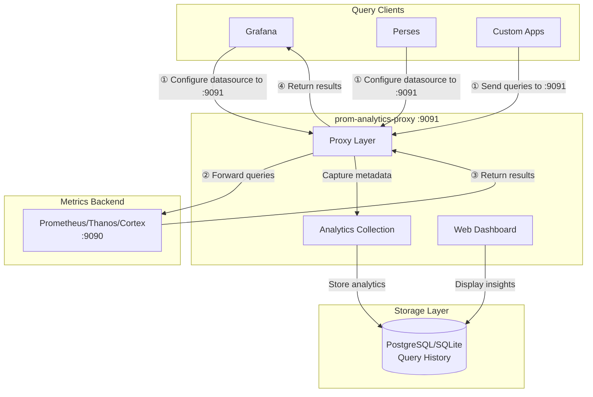

# prom-analytics-proxy

[](https://github.com/nicolastakashi/prom-analytics-proxy/actions/workflows/container-image.yaml)
[](LICENSE)
[](https://goreportcard.com/report/github.com/nicolastakashi/prom-analytics-proxy)

> **⚠️ IMPORTANT: Configuration Required**
>
> `prom-analytics-proxy` is a **man-in-the-middle proxy** that sits between your query clients (Grafana, Perses, etc.) and your metrics backend (Prometheus, Thanos, Cortex).
>
> **You MUST reconfigure your query clients to point at the proxy** (default port `:9091`) instead of directly to your metrics backend. Without this reconfiguration, the proxy will not capture any query traffic and you will see no analytics data.

## Table of Contents

- [Overview](#overview)
- [Architecture](#architecture)
- [Quick Start](#quick-start)
- [Features](#features)
- [Project Structure](#project-structure)
- [Configuration](#configuration)
- [Troubleshooting](#troubleshooting)
- [API Reference](#api-reference)

## Overview

`prom-analytics-proxy` is a powerful observability tool that acts as a transparent proxy between your Prometheus server and its clients. It provides deep insights into your PromQL query patterns, helping you optimize performance and resource usage while maintaining complete visibility into your monitoring stack.

### Watch the Introduction Video

[](https://www.youtube.com/watch?v=8PX4FwgxUd8)

*Learn how prom-analytics-proxy can help you gain insights into your Prometheus queries and optimize your monitoring setup.*

## Architecture

`prom-analytics-proxy` works as an intercepting proxy that must be placed between your query clients and your metrics backend. Understanding this architecture is crucial for successful deployment.



### How It Works

1. **Query Interception**: Your query clients (Grafana, Perses, etc.) send PromQL queries to the proxy instead of directly to your metrics backend
2. **Query Forwarding**: The proxy forwards these queries to your actual Prometheus/Thanos/Cortex instance
3. **Analytics Capture**: While proxying, it captures query patterns, execution times, series counts, and other metadata
4. **Result Passthrough**: Query results are returned to the client transparently, maintaining full compatibility
5. **Data Storage**: Analytics data is stored in PostgreSQL or SQLite for analysis
6. **Visualization**: The built-in web UI provides insights into your query patterns and performance

### Key Points

- The proxy adds minimal latency to queries (typically <10ms)
- It's completely transparent to query clients - they see the same API as Prometheus
- No changes are required to your metrics backend
- The proxy supports all PromQL query types (instant, range, series, labels, etc.)
- Works with Prometheus, Thanos, Cortex, and any Prometheus-compatible backend

## Quick Start

Get up and running in 3 simple steps:

### 1. Start the Proxy

```shell
git clone https://github.com/nicolastakashi/prom-analytics-proxy.git
cd prom-analytics-proxy

# OPTIONAL, in case of issues upgrading Golang version to one of the latest
export GOSUMDB="sum.golang.org"

make uidependencies
make uibuild
make all

./bin/prom-analytics-proxy api \
    -upstream=http://localhost:9090 \
    -database-provider=sqlite \
    -sqlite-database-path=./bin/prom-analytics-proxy.db \
    -log-level=DEBUG
```

Alternatively, using a config file:

```shell
./bin/prom-analytics-proxy api \
    -config-file=./examples/config/api/dev.yaml \
    -log-level=DEBUG
```

The proxy listens on port `:9091` by default.

### 2. Reconfigure Your Query Clients

**Critical:** Update your query clients (Grafana, Perses, etc.) to send queries to the proxy at port `:9091` instead of directly to your metrics backend.

Example for Grafana: Change your Prometheus datasource URL from `http://prometheus:9090` to `http://prom-analytics-proxy:9091`.

### 3. Verify Data Collection

Open `http://localhost:9091` and execute some queries through your clients. You should see analytics data appear in the UI.

**📖 See the complete [Quick Start Guide](docs/quick-start.md) for detailed setup instructions, configuration examples, and deployment patterns.**

### Try It Out with Docker Compose

Want to see it in action? Use our ready-to-run example:

```bash
cd examples
docker compose up -d
```

This starts a complete stack with Prometheus, the proxy, PostgreSQL, Perses dashboards, and Metrics Usage tracking. Access the proxy UI at `http://localhost:9091`.

See the [examples/](examples/) directory for configuration templates and integration examples.

## Features

### Query Analytics

- Detailed statistics on PromQL queries
- Execution time tracking
- Resource consumption metrics
- Series count analysis

### Metrics Usage

- Integration with Perses Metrics Usage
- Multi-source data correlation
- Comprehensive metrics tracking
- [Learn more about Metrics Usage Integration](#metrics-usage-integration)

### Data Storage

- PostgreSQL support
- SQLite support
- Flexible storage options
- Efficient data management

### Database migrations

- Uses Goose with embedded SQL migrations per dialect (PostgreSQL and SQLite)
- Migrations run automatically at startup; prefer a single init step in production

### User Interface

- Intuitive web-based dashboard
- Query performance visualization
- Query Shortcuts for common patterns
- Real-time analytics

### High availability

- Supported by default when database provider is set to `PostgreSQL`
  - either flag `-database-provider=postgresql`
  - or in config.yaml `database.provider: postgresql`

## Project Structure

The project is organized into two main components:

### Backend (`prom-analytics-proxy`)

- Go-based proxy application
- Query analytics collection
- Performance metrics processing
- Data storage management

### Frontend (`prom-analytics-proxy-ui`)

- React-based user interface
- Data visualization
- Query analysis tools
- Interactive dashboards

## Configuration

The application can be configured through command-line flags, environment variables or a configuration file. Here are the key configuration options:

### Environment Variables

Every flag can also be set with an environment variable. Take the flag name, uppercase it, replace `-` with `_` and add the `PROM_ANALYTICS_PROXY_` prefix:

```shell
export PROM_ANALYTICS_PROXY_UPSTREAM=http://prometheus:9090
export PROM_ANALYTICS_PROXY_DATABASE_PROVIDER=sqlite
./bin/prom-analytics-proxy api
```

Run `--help` to see the variable for each flag. Empty variables are ignored, and an invalid value stops the proxy at startup.

If a setting is defined in more than one place, the one on the right wins:

```
defaults < config file < environment variables < command-line flags
```

**Note:** previously the config file took precedence over command-line flags.

The old `POSTGRESQL_USER`, `POSTGRESQL_PASSWORD` and `POSTGRESQL_DATABASE` variables still work, but the prefixed ones are preferred.

### Basic Configuration

```yaml
# Example configuration
upstream: "http://prometheus:9090"
insecure-listen-address: ":9091"
database-provider: "postgresql" # or "sqlite"
```

### Database Configuration

```yaml
# PostgreSQL
postgresql-addr: "localhost"
postgresql-port: 5432
postgresql-database: "prom_analytics"
postgresql-user: "user"
postgresql-password: "password"

# SQLite
sqlite-database-path: "prom-analytics-proxy.db"
```

### Performance Tuning

```yaml
insert-batch-size: 10
insert-buffer-size: 100
insert-flush-interval: "5s"
insert-grace-period: "5s"
insert-timeout: "1s"
```

```bash mdox-exec="./bin/prom-analytics-proxy --help" mdox-expect-exit-code=0
Usage:
  ./bin/prom-analytics-proxy [command] [flags]

Commands:
  api       Run the proxy server (default)
  ingester  Run metrics ingester (experimental)

Flags (api):
  -config-file string
    	Path to the configuration file. Environment variables and command line flags take precedence over it. (env PROM_ANALYTICS_PROXY_CONFIG_FILE)
  -database-provider string
    	The provider of database to use for storing query data. Supported values: postgresql, sqlite. (env PROM_ANALYTICS_PROXY_DATABASE_PROVIDER)
  -include-query-stats
    	Request query stats from the upstream prometheus API. (env PROM_ANALYTICS_PROXY_INCLUDE_QUERY_STATS) (default true)
  -insecure-listen-address string
    	The address the prom-analytics-proxy proxy HTTP server should listen on. (env PROM_ANALYTICS_PROXY_INSECURE_LISTEN_ADDRESS) (default ":9091")
  -insert-batch-size int
    	Batch size for inserting queries into the database. (env PROM_ANALYTICS_PROXY_INSERT_BATCH_SIZE) (default 10)
  -insert-buffer-size int
    	Buffer size for the insert channel. (env PROM_ANALYTICS_PROXY_INSERT_BUFFER_SIZE) (default 100)
  -insert-flush-interval duration
    	Flush interval for inserting queries into the database. (env PROM_ANALYTICS_PROXY_INSERT_FLUSH_INTERVAL) (default 5s)
  -insert-grace-period duration
    	Grace period to insert pending queries after program shutdown. (env PROM_ANALYTICS_PROXY_INSERT_GRACE_PERIOD) (default 5s)
  -insert-timeout duration
    	Timeout to insert a query into the database. (env PROM_ANALYTICS_PROXY_INSERT_TIMEOUT) (default 1s)
  -inventory-enabled
    	Enable the metrics inventory syncer (env PROM_ANALYTICS_PROXY_INVENTORY_ENABLED) (default true)
  -inventory-job-index-label-timeout duration
    	Timeout for job label values collection (env PROM_ANALYTICS_PROXY_INVENTORY_JOB_INDEX_LABEL_TIMEOUT) (default 30s)
  -inventory-job-index-per-job-timeout duration
    	Timeout for processing each individual job (env PROM_ANALYTICS_PROXY_INVENTORY_JOB_INDEX_PER_JOB_TIMEOUT) (default 30s)
  -inventory-job-index-timeout duration
    	Timeout for the job index step as a whole (job label fetch plus every job processed) (env PROM_ANALYTICS_PROXY_INVENTORY_JOB_INDEX_TIMEOUT) (default 3m30s)
  -inventory-job-index-workers int
    	Number of worker goroutines for job index processing (env PROM_ANALYTICS_PROXY_INVENTORY_JOB_INDEX_WORKERS) (default 10)
  -inventory-metadata-sync-enabled
    	Enable Prometheus metadata sync to populate metrics catalog (disable when OTLP ingester handles catalog population) (env PROM_ANALYTICS_PROXY_INVENTORY_METADATA_SYNC_ENABLED) (default true)
  -inventory-metadata-timeout duration
    	Timeout for metadata collection step (env PROM_ANALYTICS_PROXY_INVENTORY_METADATA_TIMEOUT) (default 30s)
  -inventory-run-timeout duration
    	Timeout for the entire inventory sync run (env PROM_ANALYTICS_PROXY_INVENTORY_RUN_TIMEOUT) (default 5m0s)
  -inventory-summary-timeout duration
    	Timeout for summary refresh step (env PROM_ANALYTICS_PROXY_INVENTORY_SUMMARY_TIMEOUT) (default 30s)
  -inventory-sync-interval duration
    	Interval between inventory sync runs (env PROM_ANALYTICS_PROXY_INVENTORY_SYNC_INTERVAL) (default 10m0s)
  -inventory-time-window duration
    	Time window for inventory data collection (env PROM_ANALYTICS_PROXY_INVENTORY_TIME_WINDOW) (default 720h0m0s)
  -leader-election-lease-ttl duration
    	Lease TTL (lease strategy only) (env PROM_ANALYTICS_PROXY_LEADER_ELECTION_LEASE_TTL) (default 15s)
  -leader-election-renew-interval duration
    	Lease renewal interval; must be less than the lease TTL (lease strategy only) (env PROM_ANALYTICS_PROXY_LEADER_ELECTION_RENEW_INTERVAL) (default 5s)
  -leader-election-strategy string
    	Leader election strategy for the inventory syncer and retention worker when using PostgreSQL. Supported: advisory-lock, lease. (env PROM_ANALYTICS_PROXY_LEADER_ELECTION_STRATEGY) (default "advisory-lock")
  -log-format string
    	Log format (text, json) (env PROM_ANALYTICS_PROXY_LOG_FORMAT) (default "text")
  -log-level string
    	Log level (env PROM_ANALYTICS_PROXY_LOG_LEVEL) (default "INFO")
  -memory-limit-enabled
    	Enable automatic GOMEMLIMIT management via automemlimit (env PROM_ANALYTICS_PROXY_MEMORY_LIMIT_ENABLED)
  -memory-limit-ratio float
    	Ratio (0 < ratio <= 1) of detected memory limit used for GOMEMLIMIT (env PROM_ANALYTICS_PROXY_MEMORY_LIMIT_RATIO) (default 0.9)
  -memory-limit-refresh-interval duration
    	Interval for refreshing the computed memory limit (0 disables refresh) (env PROM_ANALYTICS_PROXY_MEMORY_LIMIT_REFRESH_INTERVAL) (default 1m0s)
  -metadata-limit uint
    	The maximum number of metric metadata entries to retrieve from the upstream prometheus API. (default 0 which means no limit) (env PROM_ANALYTICS_PROXY_METADATA_LIMIT)
  -postgresql-addr string
    	Address of the postgresql server. (env PROM_ANALYTICS_PROXY_POSTGRESQL_ADDR) (default "localhost")
  -postgresql-conn-max-idle-time duration
    	Maximum amount of time a connection may be idle before being closed (0 = use default 5m). (env PROM_ANALYTICS_PROXY_POSTGRESQL_CONN_MAX_IDLE_TIME)
  -postgresql-conn-max-lifetime duration
    	Maximum amount of time a connection may be reused (0 = use default 30m). (env PROM_ANALYTICS_PROXY_POSTGRESQL_CONN_MAX_LIFETIME)
  -postgresql-database string
    	Database for the postgresql server. The legacy POSTGRESQL_DATABASE env var is still read as its default. (env PROM_ANALYTICS_PROXY_POSTGRESQL_DATABASE)
  -postgresql-dial-timeout duration
    	Timeout to dial postgresql. (env PROM_ANALYTICS_PROXY_POSTGRESQL_DIAL_TIMEOUT) (default 5s)
  -postgresql-max-idle-conns int
    	Maximum number of idle connections in the pool (0 = use default 10). (env PROM_ANALYTICS_PROXY_POSTGRESQL_MAX_IDLE_CONNS)
  -postgresql-max-open-conns int
    	Maximum number of open connections to the database (0 = use default 20). (env PROM_ANALYTICS_PROXY_POSTGRESQL_MAX_OPEN_CONNS)
  -postgresql-password string
    	Password for the postgresql server. The legacy POSTGRESQL_PASSWORD env var is still read as its default. (env PROM_ANALYTICS_PROXY_POSTGRESQL_PASSWORD)
  -postgresql-port int
    	Port of the postgresql server. (env PROM_ANALYTICS_PROXY_POSTGRESQL_PORT) (default 5432)
  -postgresql-sslmode string
    	SSL mode for the postgresql server. (env PROM_ANALYTICS_PROXY_POSTGRESQL_SSLMODE) (default "disable")
  -postgresql-statement-timeout duration
    	Server-side per-statement timeout enforced by PostgreSQL on every pooled connection. When a single query exceeds this, PostgreSQL aborts it (SQLSTATE 57014) and frees the connection slot before the HTTP client can cancel it - useful as a load-shedder under saturation. Set just under the expected client per-call deadline (e.g. 4500ms when clients use 5s). 0 disables. (env PROM_ANALYTICS_PROXY_POSTGRESQL_STATEMENT_TIMEOUT)
  -postgresql-user string
    	Username for the postgresql server. The legacy POSTGRESQL_USER env var is still read as its default. (env PROM_ANALYTICS_PROXY_POSTGRESQL_USER)
  -push-metrics-usage-timeout duration
    	Timeout for PushMetricsUsage API endpoint (default 30s). (env PROM_ANALYTICS_PROXY_PUSH_METRICS_USAGE_TIMEOUT) (default 30s)
  -retention-enabled
    	Enable the retention worker to delete old data (env PROM_ANALYTICS_PROXY_RETENTION_ENABLED)
  -retention-interval duration
    	Interval between retention runs (env PROM_ANALYTICS_PROXY_RETENTION_INTERVAL) (default 1h0m0s)
  -retention-queries-max-age duration
    	Maximum age for queries before deletion (env PROM_ANALYTICS_PROXY_RETENTION_QUERIES_MAX_AGE) (default 720h0m0s)
  -retention-run-timeout duration
    	Timeout for each retention run (env PROM_ANALYTICS_PROXY_RETENTION_RUN_TIMEOUT) (default 5m0s)
  -series-limit uint
    	The maximum number of series to retrieve from the upstream prometheus API. (default 0 which means no limit) (env PROM_ANALYTICS_PROXY_SERIES_LIMIT)
  -sqlite-database-path string
    	Path to the sqlite database. (env PROM_ANALYTICS_PROXY_SQLITE_DATABASE_PATH) (default "prom-analytics-proxy.db")
  -upstream string
    	The URL of the upstream prometheus API. (env PROM_ANALYTICS_PROXY_UPSTREAM)

Flags (metrics ingester):
  -config-file string
    	Path to the configuration file. Environment variables and command line flags take precedence over it. (env PROM_ANALYTICS_PROXY_CONFIG_FILE)
  -database-provider string
    	The provider of database to use for retrieving query data. Supported values: postgresql, sqlite. (env PROM_ANALYTICS_PROXY_DATABASE_PROVIDER)
  -ingester-allowed-jobs value
    	Comma-separated list of allowed jobs to ingest metrics from (env PROM_ANALYTICS_PROXY_INGESTER_ALLOWED_JOBS)
  -ingester-cache-addr string
    	Cache server address (host:port) (env PROM_ANALYTICS_PROXY_INGESTER_CACHE_ADDR)
  -ingester-cache-batch-size int
    	Max commands per DoMulti batch (env PROM_ANALYTICS_PROXY_INGESTER_CACHE_BATCH_SIZE) (default 100)
  -ingester-cache-conn-write-timeout duration
    	Read/write timeout for Redis connections (env PROM_ANALYTICS_PROXY_INGESTER_CACHE_CONN_WRITE_TIMEOUT) (default 10s)
  -ingester-cache-db int
    	Cache database number (env PROM_ANALYTICS_PROXY_INGESTER_CACHE_DB)
  -ingester-cache-dial-timeout duration
    	TCP dial timeout for Redis connections (env PROM_ANALYTICS_PROXY_INGESTER_CACHE_DIAL_TIMEOUT) (default 5s)
  -ingester-cache-enabled
    	Enable metric usage caching (env PROM_ANALYTICS_PROXY_INGESTER_CACHE_ENABLED)
  -ingester-cache-operation-timeout duration
    	Timeout for cache get/set operations (env PROM_ANALYTICS_PROXY_INGESTER_CACHE_OPERATION_TIMEOUT) (default 200ms)
  -ingester-cache-password string
    	Cache password (optional) (env PROM_ANALYTICS_PROXY_INGESTER_CACHE_PASSWORD)
  -ingester-cache-unused-ttl duration
    	TTL for caching 'unused' metric states (env PROM_ANALYTICS_PROXY_INGESTER_CACHE_UNUSED_TTL) (default 2m0s)
  -ingester-cache-used-only
    	Only cache 'used' states, never cache 'unused' states (env PROM_ANALYTICS_PROXY_INGESTER_CACHE_USED_ONLY)
  -ingester-cache-used-ttl duration
    	TTL for caching 'used' metric states (env PROM_ANALYTICS_PROXY_INGESTER_CACHE_USED_TTL) (default 1h0m0s)
  -ingester-cache-username string
    	Cache username (optional) (env PROM_ANALYTICS_PROXY_INGESTER_CACHE_USERNAME)
  -ingester-catalog-sync-buffer-size int
    	Maximum number of unique metrics to buffer before dropping (per flush interval) (env PROM_ANALYTICS_PROXY_INGESTER_CATALOG_SYNC_BUFFER_SIZE) (default 10000)
  -ingester-catalog-sync-enabled
    	Enable catalog population from OTLP traffic (disable inventory.metadata_sync_enabled on API server when using this) (env PROM_ANALYTICS_PROXY_INGESTER_CATALOG_SYNC_ENABLED)
  -ingester-catalog-sync-flush-interval duration
    	How often to flush buffered metrics to the catalog DB (env PROM_ANALYTICS_PROXY_INGESTER_CATALOG_SYNC_FLUSH_INTERVAL) (default 30s)
  -ingester-catalog-sync-seen-ttl duration
    	How long a metric is suppressed from re-flushing after first write (reduces duplicate DB upserts) (env PROM_ANALYTICS_PROXY_INGESTER_CATALOG_SYNC_SEEN_TTL) (default 1h0m0s)
  -ingester-denied-jobs value
    	Comma-separated list of denied jobs to ingest metrics from (env PROM_ANALYTICS_PROXY_INGESTER_DENIED_JOBS)
  -ingester-drain-delay duration
    	Delay after marking NOT_SERVING before shutdown begins (env PROM_ANALYTICS_PROXY_INGESTER_DRAIN_DELAY) (default 2s)
  -ingester-dry-run
    	When true, performs filtering analysis and records metrics but does not actually drop any data (env PROM_ANALYTICS_PROXY_INGESTER_DRY_RUN)
  -ingester-graceful-timeout duration
    	Max time to wait for graceful shutdown (env PROM_ANALYTICS_PROXY_INGESTER_GRACEFUL_TIMEOUT) (default 30s)
  -ingester-metrics-listen-address string
    	The HTTP address to expose Prometheus metrics (env PROM_ANALYTICS_PROXY_INGESTER_METRICS_LISTEN_ADDRESS) (default ":9090")
  -ingester-protocol string
    	Metrics ingestion protocol (otlp) (env PROM_ANALYTICS_PROXY_INGESTER_PROTOCOL) (default "otlp")
  -log-format string
    	Log format (text, json) (env PROM_ANALYTICS_PROXY_LOG_FORMAT) (default "text")
  -log-level string
    	Log level (env PROM_ANALYTICS_PROXY_LOG_LEVEL) (default "INFO")
  -memory-limit-enabled
    	Enable automatic GOMEMLIMIT management via automemlimit (env PROM_ANALYTICS_PROXY_MEMORY_LIMIT_ENABLED)
  -memory-limit-ratio float
    	Ratio (0 < ratio <= 1) of detected memory limit used for GOMEMLIMIT (env PROM_ANALYTICS_PROXY_MEMORY_LIMIT_RATIO) (default 0.9)
  -memory-limit-refresh-interval duration
    	Interval for refreshing the computed memory limit (0 disables refresh) (env PROM_ANALYTICS_PROXY_MEMORY_LIMIT_REFRESH_INTERVAL) (default 1m0s)
  -otlp-balancer-name string
    	gRPC load balancer name for downstream OTLP client (e.g., round_robin). If empty, defaults to pick_first (env PROM_ANALYTICS_PROXY_OTLP_BALANCER_NAME)
  -otlp-downstream-address string
    	Optional downstream OTLP gRPC address to forward filtered metrics (env PROM_ANALYTICS_PROXY_OTLP_DOWNSTREAM_ADDRESS)
  -otlp-downstream-connect-backoff-multiplier float
    	Multiplier applied to downstream OTLP client dial backoff (env PROM_ANALYTICS_PROXY_OTLP_DOWNSTREAM_CONNECT_BACKOFF_MULTIPLIER) (default 1.6)
  -otlp-downstream-connect-base-delay duration
    	Base delay for downstream OTLP client dial backoff (env PROM_ANALYTICS_PROXY_OTLP_DOWNSTREAM_CONNECT_BASE_DELAY) (default 250ms)
  -otlp-downstream-connect-max-delay duration
    	Max delay for downstream OTLP client dial backoff (env PROM_ANALYTICS_PROXY_OTLP_DOWNSTREAM_CONNECT_MAX_DELAY) (default 5s)
  -otlp-downstream-connect-min-timeout duration
    	Minimum connect timeout for downstream OTLP client dial attempts (env PROM_ANALYTICS_PROXY_OTLP_DOWNSTREAM_CONNECT_MIN_TIMEOUT) (default 500ms)
  -otlp-downstream-max-recv-bytes int
    	Max gRPC receive message size for downstream OTLP client (bytes) (env PROM_ANALYTICS_PROXY_OTLP_DOWNSTREAM_MAX_RECV_BYTES) (default 10485760)
  -otlp-downstream-max-send-bytes int
    	Max gRPC send message size for downstream OTLP client (bytes) (env PROM_ANALYTICS_PROXY_OTLP_DOWNSTREAM_MAX_SEND_BYTES) (default 10485760)
  -otlp-downstream-retry-backoff-multiplier float
    	Downstream OTLP retry backoff multiplier (env PROM_ANALYTICS_PROXY_OTLP_DOWNSTREAM_RETRY_BACKOFF_MULTIPLIER) (default 1.6)
  -otlp-downstream-retry-codes value
    	Comma-separated gRPC status codes to retry (e.g., UNAVAILABLE,RESOURCE_EXHAUSTED) (env PROM_ANALYTICS_PROXY_OTLP_DOWNSTREAM_RETRY_CODES)
  -otlp-downstream-retry-initial-backoff duration
    	Downstream OTLP retry initial backoff (duration) (env PROM_ANALYTICS_PROXY_OTLP_DOWNSTREAM_RETRY_INITIAL_BACKOFF) (default 250ms)
  -otlp-downstream-retry-max-attempts int
    	Downstream OTLP retry max attempts (env PROM_ANALYTICS_PROXY_OTLP_DOWNSTREAM_RETRY_MAX_ATTEMPTS) (default 2)
  -otlp-downstream-retry-max-backoff duration
    	Downstream OTLP retry max backoff (duration) (env PROM_ANALYTICS_PROXY_OTLP_DOWNSTREAM_RETRY_MAX_BACKOFF) (default 1s)
  -otlp-listen-address string
    	The address the metrics ingester should listen on. (env PROM_ANALYTICS_PROXY_OTLP_LISTEN_ADDRESS) (default ":4317")
  -otlp-lookup-chunk-size int
    	Batch size for database lookups when checking metric usage (default 500, SQLite max 999) (env PROM_ANALYTICS_PROXY_OTLP_LOOKUP_CHUNK_SIZE) (default 500)
  -otlp-max-recv-bytes int
    	Max gRPC receive message size for OTLP server (bytes) (env PROM_ANALYTICS_PROXY_OTLP_MAX_RECV_BYTES) (default 10485760)
  -otlp-max-send-bytes int
    	Max gRPC send message size for OTLP server (bytes) (env PROM_ANALYTICS_PROXY_OTLP_MAX_SEND_BYTES) (default 10485760)
  -postgresql-addr string
    	Address of the postgresql server. (env PROM_ANALYTICS_PROXY_POSTGRESQL_ADDR) (default "localhost")
  -postgresql-conn-max-idle-time duration
    	Maximum amount of time a connection may be idle before being closed (0 = use default 5m). (env PROM_ANALYTICS_PROXY_POSTGRESQL_CONN_MAX_IDLE_TIME)
  -postgresql-conn-max-lifetime duration
    	Maximum amount of time a connection may be reused (0 = use default 30m). (env PROM_ANALYTICS_PROXY_POSTGRESQL_CONN_MAX_LIFETIME)
  -postgresql-database string
    	Database for the postgresql server. The legacy POSTGRESQL_DATABASE env var is still read as its default. (env PROM_ANALYTICS_PROXY_POSTGRESQL_DATABASE)
  -postgresql-dial-timeout duration
    	Timeout to dial postgresql. (env PROM_ANALYTICS_PROXY_POSTGRESQL_DIAL_TIMEOUT) (default 5s)
  -postgresql-max-idle-conns int
    	Maximum number of idle connections in the pool (0 = use default 10). (env PROM_ANALYTICS_PROXY_POSTGRESQL_MAX_IDLE_CONNS)
  -postgresql-max-open-conns int
    	Maximum number of open connections to the database (0 = use default 20). (env PROM_ANALYTICS_PROXY_POSTGRESQL_MAX_OPEN_CONNS)
  -postgresql-password string
    	Password for the postgresql server. The legacy POSTGRESQL_PASSWORD env var is still read as its default. (env PROM_ANALYTICS_PROXY_POSTGRESQL_PASSWORD)
  -postgresql-port int
    	Port of the postgresql server. (env PROM_ANALYTICS_PROXY_POSTGRESQL_PORT) (default 5432)
  -postgresql-sslmode string
    	SSL mode for the postgresql server. (env PROM_ANALYTICS_PROXY_POSTGRESQL_SSLMODE) (default "disable")
  -postgresql-statement-timeout duration
    	Server-side per-statement timeout enforced by PostgreSQL on every pooled connection. When a single query exceeds this, PostgreSQL aborts it (SQLSTATE 57014) and frees the connection slot before the HTTP client can cancel it - useful as a load-shedder under saturation. Set just under the expected client per-call deadline (e.g. 4500ms when clients use 5s). 0 disables. (env PROM_ANALYTICS_PROXY_POSTGRESQL_STATEMENT_TIMEOUT)
  -postgresql-user string
    	Username for the postgresql server. The legacy POSTGRESQL_USER env var is still read as its default. (env PROM_ANALYTICS_PROXY_POSTGRESQL_USER)
  -sqlite-database-path string
    	Path to the sqlite database. (env PROM_ANALYTICS_PROXY_SQLITE_DATABASE_PATH) (default "prom-analytics-proxy.db")
```

### Tracing Support

The prom-analytics-proxy application includes built-in support for distributed tracing using OpenTelemetry. To enable tracing, you must provide a configuration file specifying the tracing settings. Below is an example configuration and details for each option:

```yaml
tracing:
  client_type: ""
  service_name: ""
  resource_attributes: {}
  reconnection_period: 0s
  compression: ""
  insecure: false
  endpoint: ""
  url_path: ""
  timeout: 0s
  retry_config:
    retry_enabled: false
    retry_initial_interval: 0s
    retry_max_interval: 0s
    retry_max_elapsed_time: 0s
  headers: {}
  tls_config:
    ca_file: ""
    cert_file: ""
    key_file: ""
    server_name: ""
    insecure_skip_verify: false
  sampler_type: ""
  sampler_param: ""
```

### Metrics Usage Integration

The `prom-analytics-proxy` application integrates with Perses Metrics Usage to gather and correlate metrics usage data from multiple sources. Essentially, `prom-analytics-proxy` acts as a backend for the Metrics Usage frontend, providing the data needed to populate the UI.

Because Metrics Usage is a separate project, you must deploy it alongside `prom-analytics-proxy` to enable this feature. Once configured, `prom-analytics-proxy` sends the collected data to the Metrics Usage backend, which is then displayed in the Metrics Usage UI. For more information, see the [Metrics Usage repository](https://github.com/perses/metrics-usage).

**Try it out:** The [proxy-only](examples/demo/proxy-only) and [full](examples/demo/full) demos include complete setups with Metrics Usage integration. Configuration files are available in [examples/proxy/config/metrics-usage/](examples/demo/proxy-only/config/metrics-usage/).

### Inventory Configuration

The inventory syncer maintains a catalog of metrics and their usage patterns. It uses concurrent processing to handle large numbers of jobs efficiently. It can be configured with the following options:

```yaml
inventory:
  enabled: true              # Enable inventory syncing (default: true)
  metadata_sync_enabled: true # Fetch metric metadata from Prometheus to populate the catalog (default: true)
                             # Set to false when using the OTLP ingester to populate the catalog instead.
  sync_interval: 10m         # How often to sync inventory (default: 10m)
  time_window: 720h          # Time window for usage analysis (default: 30 days)
  run_timeout: 300s          # Timeout for an entire sync run (default: 300s)
                             # Must be at least the sum of every enabled step timeout below,
                             # plus 10s of overrun allowance per enabled step; a smaller value
                             # is raised to that floor at startup, with a warning.
  metadata_step_timeout: 30s # Timeout for metadata fetch (default: 30s)
  summary_step_timeout: 30s  # Timeout for usage summary refresh (default: 30s)
  job_sync_enabled: false    # Build the per-job metric index (default: false)
                             # When true, job_index_timeout counts toward run_timeout's minimum.
  job_index_timeout: 210s    # Timeout for the job index step as a whole (default: 210s)
  job_index_label_timeout: 30s   # Timeout for job label fetch (default: 30s)
  job_index_per_job_timeout: 30s # Timeout for one job's whole turn - query and commit (default: 30s)
  job_index_workers: 10      # Number of concurrent workers for job processing (default: 10)
```

**📖 See the [Background Jobs guide](docs/jobs.md) for what each step does, how the time budget fits together, and the same reference for the retention worker.**

**Performance Notes:**

- For environments with hundreds of jobs (500+), increase `job_index_workers` to 20-50 for faster processing
- When processing many jobs, raise `job_index_timeout` — it, not `job_index_per_job_timeout`, is what bounds the step as a whole — and raise `run_timeout` by at least as much, since it has to stay above every enabled step's timeout plus their overrun allowance
- Each worker processes one job at a time, so more workers = faster job index building

### Ingester & Deployment Modes

The OTLP ingester enables write-path filtering of unused metrics and can populate the metrics catalog directly from live traffic — without depending on the Prometheus metadata API.

The proxy supports two deployment modes:

- **Analytics-Only** (default) — single instance, catalog populated from Prometheus metadata sync.
- **Ingester Mode** — two separate instances sharing a database; the ingester populates the catalog, the API server handles usage aggregation only.

**📖 See the [Ingester & Deployment Modes guide](docs/ingester.md) for full configuration details, architecture diagrams, and observability metrics.**

## Troubleshooting

### Common Issues

**Not seeing any data in the UI?**

The most common issue is that query clients are still connecting directly to your metrics backend instead of through the proxy. Make sure you've reconfigured your clients (Grafana, Perses, etc.) to use the proxy URL (`:9091`).

**Context deadline exceeded errors?**

Your metrics backend may be slow to respond. Increase timeout values, especially for large Thanos deployments:

```bash
./prom-analytics-proxy \
  -upstream http://thanos:9090 \
  -inventory-job-index-per-job-timeout 60s \
  -inventory-run-timeout 10m
```

**Performance issues?**

Tune the insert buffer settings and consider using PostgreSQL instead of SQLite for better concurrent write performance.

**📖 See the complete [Troubleshooting Guide](docs/troubleshooting.md) for detailed solutions to common issues, performance tuning, and debugging tips.**

## API Reference

The proxy provides several API endpoints for accessing query analytics and metrics inventory data. The full OpenAPI specification is available in [`docs/swagger.yaml`](docs/swagger.yaml) and can be viewed interactively when the server is running at `/swagger/` (if configured with Swagger UI).

### Query Analytics API

- `GET /api/v1/query/expressions` - Retrieve query analytics data with pagination and filtering

### Series Metadata

- `GET /api/v1/seriesMetadata` - Retrieve metrics catalog and usage information

#### Parameters

- `page` (int): Page number for pagination (default: 1)
- `pageSize` (int): Number of items per page (default: 10, max: 100)
- `sortBy` (string): Sort field - `name`, `type`, `alertCount`, `recordCount`, `dashboardCount`, `queryCount` (default: `name`)
- `sortOrder` (string): Sort direction - `asc` or `desc` (default: `asc`)
- `filter` (string): Filter metrics by name or help text
- `type` (string): Filter by metric type - `counter`, `gauge`, `histogram`, `summary`, etc.
- `usage` (string): Filter metrics by usage state - `all`, `used`, or `unused`
- `job` (string): Filter to show metrics produced by a specific job

#### Examples

```bash
# Get all metrics with pagination
curl "http://localhost:9091/api/v1/seriesMetadata?page=1&pageSize=20"

# Find used metrics
curl "http://localhost:9091/api/v1/seriesMetadata?usage=used"

# Find unused metrics for a specific job
curl "http://localhost:9091/api/v1/seriesMetadata?usage=unused&job=myapp"

# Search for HTTP-related metrics
curl "http://localhost:9091/api/v1/seriesMetadata?filter=http&type=counter"
```

#### Response Format

```json
{
  "data": [
    {
      "name": "http_requests_total",
      "type": "counter",
      "help": "Total number of HTTP requests",
      "unit": "",
      "alertCount": 2,
      "recordCount": 1,
      "dashboardCount": 3,
      "queryCount": 45,
      "lastQueriedAt": "2024-01-15T10:30:00Z",
      "seriesCount": 12
    }
  ],
  "pagination": {
    "page": 1,
    "pageSize": 20,
    "total": 150,
    "totalPages": 8
  }
}
```

### Push Query Data using API

`POST /api/v1/query/push` Push query data to the server, for cases when you have other means of collecting PromQL queries stats.

#### Request Format

```jsonnet
[
  {
    "type": "instant",                     // REQUIRED Type of the query, one of `range` or `instant`
    "query_param": "up{job='foobar'}",     // REQUIRED The PromQL expression of the query
    "time_param": "2024-01-15T10:30:00Z",  // The time when the query was evaluated, only for type `instant` in RFC 3339 format
    "duration": 250000000,                 // Duration of the query in nanoseconds
    "status_code": 200,                    // REQUIRED Valid HTTP status code, see https://go.dev/src/net/http/status.go
    "body_size": 512,                      // Response body size in bytes
    "step": 15,                            // REQUIRED(for type `range`) Range query step in seconds
    "start": "2024-01-15T10:30:00Z",       // REQUIRED(for type `range`) Range query start time in RFC 3339 format
    "end": "2024-01-15T10:30:00Z",         // REQUIRED(for type `range`) Range query end in RFC 3339 format
    "total_queryable_samples": 1000,       // Total samples that were queryable
    "peak_samples": 1000,                  // Maximum samples processed at any point in time
  },
  ...
]
```

### Metrics Discovery

The inventory system automatically discovers metrics from your Prometheus server and tracks their usage across:

- **Alerting rules**: Metrics used in alert expressions
- **Recording rules**: Metrics used in recording rule expressions
- **Dashboards**: Metrics queried by dashboard panels (when integrated with dashboard usage tracking)
- **Ad-hoc queries**: Direct PromQL queries through the proxy

### Job-Based Usage Analysis

When the `job` parameter is provided with `unused=true`, the system:

1. Filters metrics to only those produced by the specified job (using the job index)
2. Applies the global "unused" criteria (no usage in alerts, recording rules, dashboards, or queries)
3. Returns the series count for that specific job

This helps identify metrics that are being produced by a service but aren't being actively monitored or used.
