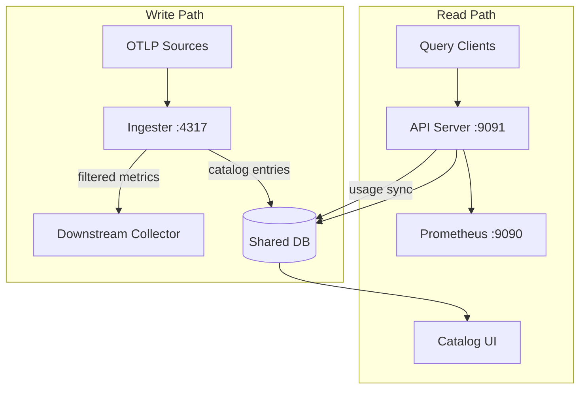

# OTLP Ingester & Deployment Modes

The OTLP ingester is an optional component that sits on the **write path** of your metrics pipeline. It receives OTLP metrics, filters unused ones based on the catalog, and forwards the remainder to a downstream backend (e.g. an OTel Collector or Prometheus remote-write receiver).

## Deployment Modes

The proxy supports two distinct deployment modes depending on whether the OTLP ingester is used.

### Analytics-Only Mode (default)

A single instance runs both the API server and the inventory syncer. Metrics are discovered by pulling metadata from Prometheus on a schedule. No ingester is required.


**Configuration:**

```yaml
# config.yaml
inventory:
  enabled: true
  metadata_sync_enabled: true  # default — fetch catalog from Prometheus
```

This is the right mode when you want query analytics and visibility into unused metrics, but do not need automatic write-path filtering.

### Ingester Mode

Two separate instances share the same database:

- **Ingester instance** — receives OTLP metrics, filters unused ones, populates the catalog from live traffic.
- **API server instance** — handles query analytics, the catalog UI, and usage aggregation (alerts, recording rules, dashboards, queries). Does **not** fetch Prometheus metadata since the ingester provides the catalog.



**API server config:**

```yaml
inventory:
  enabled: true
  metadata_sync_enabled: false  # ingester handles catalog population
```

**Ingester config:**

```yaml
ingester:
  catalog_sync:
    enabled: true
    flush_interval: 30s
    seen_ttl: 1h
  redis:
    enabled: true     # recommended: persists seen state across restarts
    addr: redis:6379
```

## Catalog Sync Configuration

When `catalog_sync.enabled` is true, the ingester buffers metric metadata seen in OTLP batches and periodically flushes it to the `metrics_catalog` table.

| Option | Default | Description |
|--------|---------|-------------|
| `enabled` | `false` | Enable catalog population from OTLP traffic |
| `flush_interval` | `30s` | How often to flush buffered metrics to the DB |
| `buffer_size` | `10000` | Maximum unique metrics to buffer per flush interval |
| `seen_ttl` | `1h` | Suppression window after a metric is flushed. After expiry the metric is re-written to refresh `last_synced_at` |

### Deduplication

The ingester avoids redundant DB upserts with a two-layer strategy:

1. **Pending map** — within a flush interval each metric name is queued at most once, regardless of how many OTLP batches contain it.
2. **Seen state** — after a successful flush, metrics are suppressed from re-queuing until `seen_ttl` expires.

The seen state is stored differently depending on whether Redis is configured:

| Redis | Seen state storage | Restart behaviour |
|-------|--------------------|-------------------|
| Disabled | In-memory map | Lost on restart; one re-flush burst at startup |
| Enabled | Redis (`catalog_seen:` key prefix) | Survives restarts; no re-flush burst |

When Redis is enabled, the same connection settings as the metric usage cache are reused (`ingester.redis.*`). No additional Redis configuration is needed.

## Inventory Syncer — `metadata_sync_enabled`

The `inventory.metadata_sync_enabled` flag controls whether the syncer fetches metric metadata from Prometheus and writes it to `metrics_catalog`:

- **`true` (default)** — full sync: fetch metadata from `/api/v1/metadata`, upsert catalog, refresh usage summary.
- **`false`** — usage-only sync: skip metadata fetch, only run `RefreshMetricsUsageSummary`. Use this on the API server when the ingester is handling catalog population.

Usage summary aggregation (alert counts, recording rule counts, dashboard counts, query counts) always runs regardless of this flag.

## Running the Ingester

```bash
./prom-analytics-proxy ingester \
  -database-provider postgresql \
  -postgresql-addr postgres.example.com \
  -otlp-listen-address :4317 \
  -otlp-downstream-address collector:4317 \
  -ingester-catalog-sync-enabled \
  -ingester-catalog-sync-flush-interval 30s \
  -ingester-catalog-sync-seen-ttl 1h \
  -ingester-cache-enabled \
  -ingester-cache-addr redis:6379
```

Or via config file:

```yaml
ingester:
  otlp:
    listen_address: ":4317"
    downstream_address: "collector:4317"
  catalog_sync:
    enabled: true
    flush_interval: 30s
    buffer_size: 10000
    seen_ttl: 1h
  redis:
    enabled: true
    addr: "redis:6379"
    used_ttl: 1h
    unused_ttl: 2m
```

## Observability

The ingester exposes Prometheus metrics on `-ingester-metrics-listen-address` (default `:9090`, path `/metrics`). Every metric described here is prefixed with `ingester_`.

### Export requests

| Metric | Type | Labels | Description |
|--------|------|--------|-------------|
| `ingester_rpc_server_duration_seconds` | Histogram | `rpc.system`, `rpc.service`, `rpc.method`, `network.transport`, `code` | Duration of each OTLP `Export` request the ingester receives. `code` is the gRPC status returned to the sender (`OK`, `Canceled`, `DeadlineExceeded`, `Unavailable`, ...); the other labels are constant (`grpc`, `opentelemetry.proto.collector.metrics.v1.MetricsService`, `Export`, `tcp`). Use `_count` for request and error rates. |
| `ingester_rpc_inflight` | Gauge | | `Export` requests currently being processed. |
| `ingester_receiver_received_metric_points_total` | Counter | | Data points received, before any filtering. |
| `ingester_receiver_missing_job_total` | Counter | | Unused metrics whose resource has neither a `job` nor a `service.name` attribute, counted once per metric when deciding whether to drop it. Such metrics are dropped only when no allow list is set. |

### Filtering

| Metric | Type | Labels | Description |
|--------|------|--------|-------------|
| `ingester_processor_dropped_metric_points_total` | Counter | `reason` | Data points removed because their metric is unused (`reason="unused_metric"`). With `-ingester-dry-run` it counts the points that would have been removed, while nothing is dropped. A `reason="job_denied"` series is exported but never incremented: jobs excluded by the allow or deny lists are forwarded unfiltered and not counted here. |

### Usage lookups

Each request resolves the usage state of its metric names from the Redis cache first (when `-ingester-cache-enabled` is set), then from the database for the names the cache does not answer, in chunks of `-otlp-lookup-chunk-size`.

| Metric | Type | Labels | Description |
|--------|------|--------|-------------|
| `ingester_metric_cache_hits_total` | Counter | `state` | Names answered by the cache, by cached state (`used`, `unused`). With `-ingester-cache-used-only`, cached `unused` entries are counted as misses. |
| `ingester_metric_cache_misses_total` | Counter | | Names the cache did not resolve to a state, which go on to the database: names with no entry or an unrecognised value, and, with `-ingester-cache-used-only`, cached `unused` entries. Names a failed read did not answer also go to the database, but are not counted here. |
| `ingester_metric_cache_errors_total` | Counter | `operation`, `reason` | Failed cache calls, once per call, by `operation` (`get`, `set`) and `reason`: `timeout` when the call ran out of time, `error` otherwise. Calls made for a canceled request are not counted. |
| `ingester_metric_cache_lookup_seconds` | Histogram | | Duration of each cache read, per chunk, including reads that failed or timed out. |
| `ingester_metric_cache_write_seconds` | Histogram | | Duration of each cache write-back of states read from the database, whether or not the write succeeded. |
| `ingester_processor_lookup_duration_seconds` | Histogram | `outcome` | Duration of each database lookup, per chunk, by `outcome`: `ok`, `timeout` when it ran out of time or the database timed the statement out, `error` otherwise. Lookups for a canceled request are not observed. |
| `ingester_processor_lookup_errors_total` | Counter | | Failed database lookups, per chunk, not counting canceled requests. The names in a failed chunk are treated as used and forwarded. |
| `ingester_processor_usage_resolutions_total` | Counter | `source` | Names looked up, each counted once per request, by what resolved their usage state: `cache`, `database` (including names it has no record of, which are kept), or `unresolved` (forwarded as used). Names of a canceled request are not counted as unresolved. |
| `ingester_processor_unresolved_total` | Counter | `reason` | Names forwarded as used because their usage state could not be resolved, by `reason`: `db_timeout`, `db_error`. Breaks down `ingester_processor_usage_resolutions_total{source="unresolved"}`. |

### Downstream forwarding

| Metric | Type | Labels | Description |
|--------|------|--------|-------------|
| `ingester_rpc_client_duration_seconds` | Histogram | `rpc.system`, `rpc.service`, `rpc.method`, `network.transport`, `code` | Duration of each `Export` call to `-otlp-downstream-address`, including retries made by the gRPC retry policy (`-otlp-downstream-retry-*`). `code` is the gRPC status of the call. |
| `ingester_exporter_retries_total` | Counter | | Second `Export` attempts the ingester makes after a call fails with `Unavailable`. Retries made by the gRPC retry policy are not counted. |

### Catalog sync

| Metric | Type | Labels | Description |
|--------|------|--------|-------------|
| `ingester_catalog_buffer_size` | Gauge | | Unique metrics waiting in the buffer for the next flush. |
| `ingester_catalog_buffer_dropped_total` | Counter | | Metrics discarded because the buffer was full, either when buffered or when re-queued after a failed flush. |
| `ingester_catalog_flush_duration_seconds` | Histogram | | Duration of each successful flush to the database. |
| `ingester_catalog_flush_metrics_total` | Counter | | Metrics written to the catalog by successful flushes. |
| `ingester_catalog_flush_errors_total` | Counter | | Failed flushes. Their metrics are re-queued for the next flush, up to the buffer size; the rest count as dropped. |

See [Troubleshooting](troubleshooting.md#ingester-export-observability) for PromQL examples and log events.
